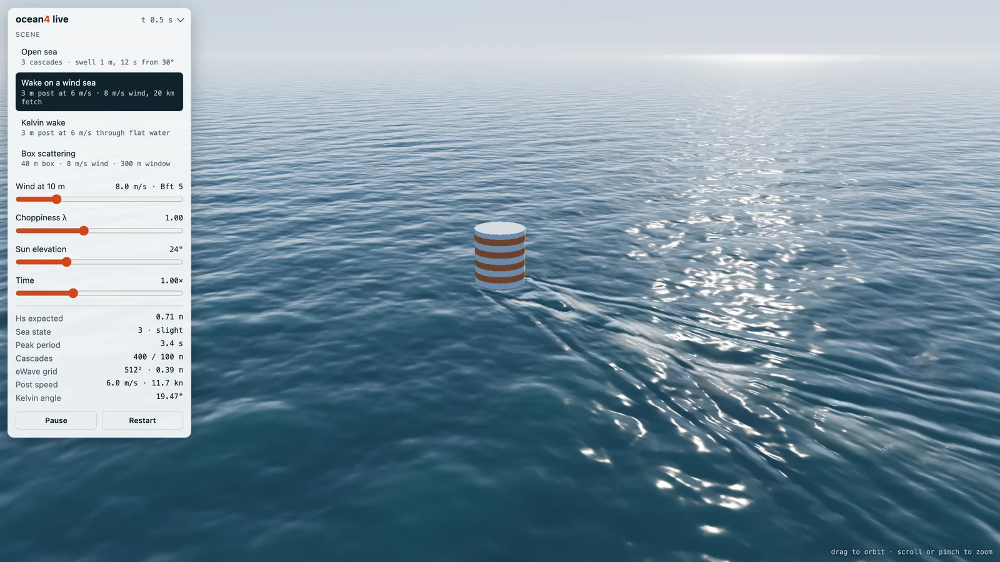

# Ocean4 Live

A live FFT ocean in one HTML file: wind sea, swell, chop, whitecaps and a real Kelvin wake, simulated on your GPU every frame. No libraries, no assets, no build step to run it.

**Open it:** https://codewithbehnam.github.io/ocean4-live/

| | Size |
|---|---|
| `index.html` on disk | 35,298 bytes (35 KB) |
| Download, gzip as served by GitHub Pages | 15,200 bytes (15 KB) |
| With brotli | 13,757 bytes |

## Scenes

| Link | Scene |
|---|---|
| [`#scene=0`](https://codewithbehnam.github.io/ocean4-live/#scene=0) | Open sea: three FFT cascades (1000, 250 and 60 m), JONSWAP wind sea at 12 m/s, 1 m swell with a 12 s period |
| [`#scene=1`](https://codewithbehnam.github.io/ocean4-live/#scene=1) | Wake on a wind sea: a 3 m post moving at 6 m/s through an 8 m/s sea |
| [`#scene=2`](https://codewithbehnam.github.io/ocean4-live/#scene=2) | Kelvin wake: the same post in flat water |
| [`#scene=3`](https://codewithbehnam.github.io/ocean4-live/#scene=3) | Box scattering: wind waves diffracting round a fixed 40 m box |

Drag to orbit, scroll or pinch to zoom. The panel sets wind speed, choppiness, sun elevation and time speed, and shows significant wave height, WMO sea state, peak period and Beaufort force.

## The science

- **Jerry Tessendorf, "Simulating Ocean Water"**, SIGGRAPH course notes (1999 to 2004). The sea is a sum of tens of thousands of waves per patch, evaluated with FFTs, with the horizontal "choppy" displacement and the dispersion relation ω² = gk.
- **Jerry Tessendorf, "eWave: Using an Exponential Solver on the iWave Problem"** (2014). Objects in the water: height and velocity potential are advanced in Fourier space by cos and sin of ωΔt, which is exact for any time step and has no numerical damping. A 3 m post at 6 m/s produces the Kelvin pattern.
- **Jerry Tessendorf, "Gilligan: A Prototype Framework for Simulating and Rendering Maritime Environments"**, Clemson University. The eWave update order, the boundary trim that absorbs waves at the window edge, and the whitecap model.
- **K. Hasselmann et al. (1973)**, the JONSWAP wind-sea spectrum, and **Hasselmann, Dunckel and Ewing (1980)**, the directional spreading used with it.
- **Lord Kelvin, "On Ship Waves" (1887)**: the 19.47° half-angle of a deep-water wake.
- **Melissa O'Neill, PCG (2014)**: the random generator that draws the wave amplitudes, so a seed gives the same sea as the reference C program.

## How it works

The page is a WebGL2 port of `ocean4.c`, a C11 implementation of the work above.

- **Ocean:** the spectrum and the Gaussian draw run once in JavaScript, then three cascades are updated on the GPU every frame with radix-4 FFTs, giving height, horizontal displacement, slopes, the displacement Jacobian and surface velocity.
- **Wakes and scattering:** eWave runs on a 512 × 512 grid. For the moving post the grid travels with it, using the solver's own drift-current term, so the wake never runs out of room.
- **Whitecaps:** foam starts where the smaller eigenvalue of the Jacobian drops below a threshold, then rides the surface velocity and decays.
- **Drawing:** an endless grid centred on the camera, per-pixel normals of the chopped surface, Fresnel reflection of a procedural sky, sun glitter and distance haze. Frames are capped at 60 per second and drawn at up to about 1440p, so a 5K display costs about 2 to 3 ms of GPU time per frame on an Apple M2 Max.

**Accuracy:** the unminified source has a check mode that re-runs the C program's example scenes. Its heights match `ocean4.c` to within a few micrometres, and the Kelvin wake to within 0.1%. This repository holds only the minified build.

## Requirements

WebGL2 with float render targets (`EXT_color_buffer_float`): current Chrome, Edge, Firefox and Safari.

## Credits

Physics and methods by the authors above. Built with Claude Fable 5.1 and Claude Opus 5.5.
